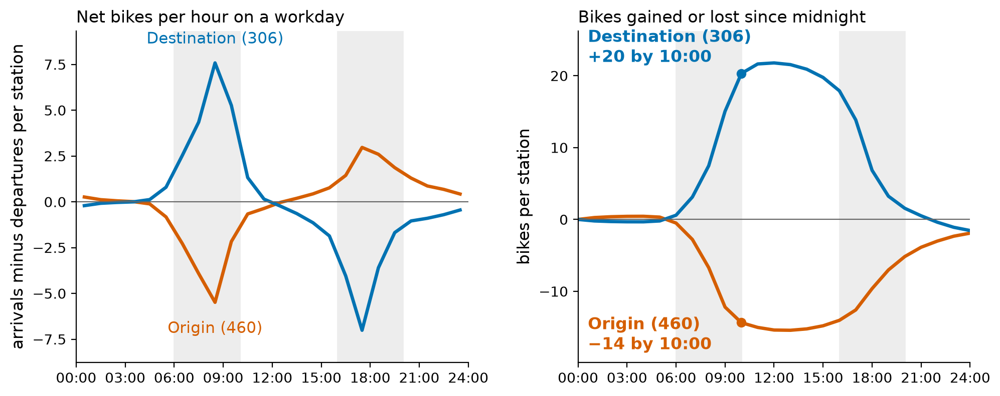
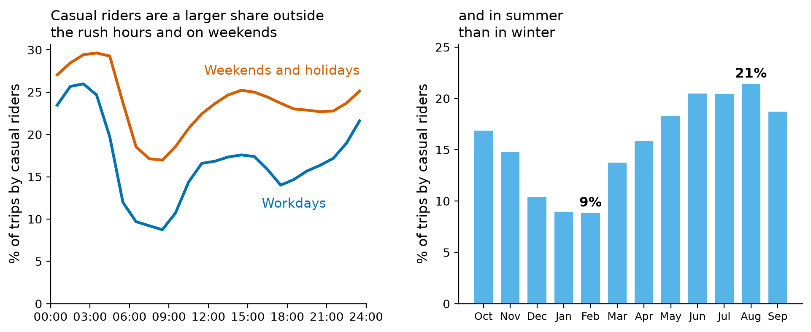
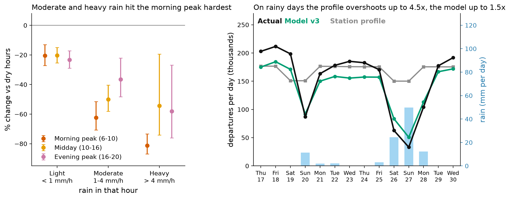
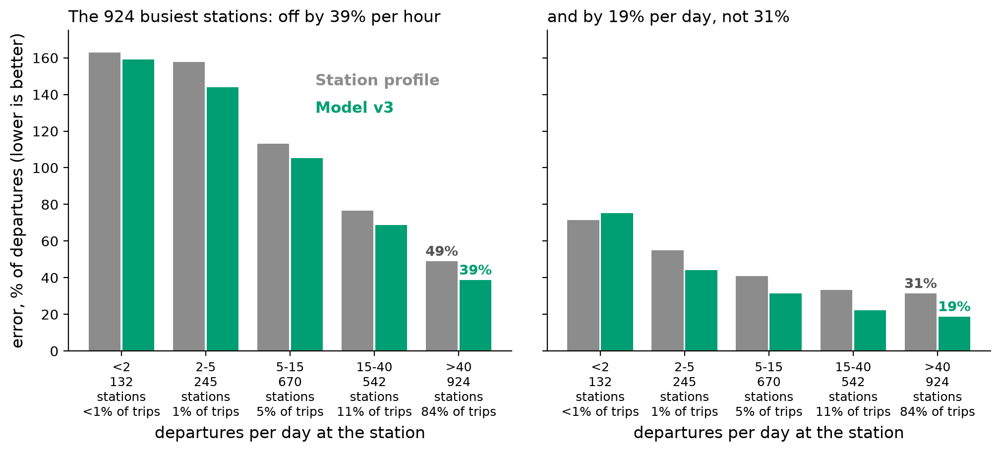

# Demand findings

This page gives five findings about what drives Citi Bike demand and what operations can do about each of them.
They use the same 12 months (Oct 2025 to Sep 2026) and the same 45,226,146 clean trips as the model, see [ml-data.md](ml-data.md).
`notebooks/HALLAZGOS_demanda.ipynb` produces every number and figure, and writes the tables to `data/results/findings_*.csv` and `data/results/findings_numbers.json`.
Findings 1 to 3 describe the trips.
Findings 4 and 5 score the shipped model (v3, refit through Sep 16) on the test block of [evaluation.md](evaluation.md) (Sep 17 to 30), against the baseline to beat.

## Summary

| # | Cause | Finding | Action |
| --- | --- | --- | --- |
| 1 | Hour and station type | 766 stations (33% of the 2,337 that could be described) gain or lose 5 or more bikes net between 06:00 and 10:00 on a workday, and 97% or more of each type reverse in the evening | Refill origin stations before 06:00 and clear destination stations before 10:00, on workdays only |
| 2 | User type | Casual riders are 9% of trips at 08:00 on workdays and 24% at 17:00 on weekends and holidays, and 9% of trips in February against 21% in August | Plan weekends and holidays apart, and reinforce leisure stations on weekend afternoons |
| 3 | Weather | Rain cuts demand by 22% (light), 47% (moderate) and 59% (heavy), and the morning peak falls the most | Scale refills to the forecast, and treat the forecast of a very wet day as an upper bound |
| 4 | Uncertainty | The 924 busiest stations (37% of stations, 84% of trips) are forecast within 19% per day and 39% per hour, and the 377 quietest (1% of trips) are not plannable | Plan with the point forecast for busy stations and with the interval for the rest |
| 5 | What the model adds | A station profile already finds the stations that lose bikes (both pick 74 of the 100 largest losers), and the model adds the weather: the daily error is 15% against 51% | Use the profile to decide where and the model to decide how many |

## 1. The commute tide: hour and station type

Mean over the stations of each type on workdays.
The bands mark 06:00 to 10:00 and 16:00 to 20:00.

- On an average workday 766 of the 2,337 stations that could be described change by 5 or more bikes net between 06:00 and 10:00 (460 lose bikes, 306 gain them).
- 96.5% of the origins gain bikes in the evening and 96.7% of the destinations lose them, so the morning pattern predicts the evening one.
- The extremes are `9 Ave & W 33 St` (+103 bikes in the morning, −104 in the evening) and `W 43 St & 10 Ave` (−72 and +49).
- Weekend demand follows the type: destination stations (offices) fall to 68% of their workday demand and leisure stations rise to 129%.

| Type | Rule | Stations | Workday trips | Net bikes 06-10 | Net bikes 16-20 | Weekend vs workday | Action |
| --- | --- | --- | --- | --- | --- | --- | --- |
| Origin | net 06-10 of -5 or less | 460 | 38% | −13.9 | +8.9 | 91% | Refill before 06:00 |
| Destination | net 06-10 of +5 or more | 306 | 32% | +19.7 | −16.3 | 68% | Clear before 10:00, workdays only |
| Leisure | weekend demand at least 115% of workday | 78 | 3% | −0.4 | +1.4 | 129% | Reinforce on Friday afternoon and weekends |
| Balanced | the rest | 843 | 25% | −0.8 | +0.3 | 85% | No scheduled route, watch the interval |
| Low use | under 10 departures per workday | 650 | 3% | +0.3 | +1.1 | 86% | Do not plan with the point forecast |

- Weekend means weekend days and federal holidays.
- The thresholds are round numbers chosen by eye from the distributions of the station features, and were not tuned to any score.
- 178 of the 2,515 model stations did not have enough full days (100 workdays and 40 weekend days) and are not typed.
- The net flow counts trips only.
  Rebalancing by truck is not observed, so it does not show up here.
- Stations are listed in `data/results/findings_station_profiles.csv`.

## 2. Who rides: members, casual riders and electric bikes

- Casual riders make 17.3% of the trips.
  They are 8.7% of the trips at 08:00 on workdays and 23.7% at 17:00 on weekends and holidays.
- A workday has 111,313 member trips and 19,557 casual trips, and a weekend day or holiday has 83,289 and 25,482: member trips fall by 25% and casual trips rise by 30%.
- The casual share goes from 8.9% in February 2026 to 21.4% in August 2026.
- By station the casual share has a median of 17% and reaches 72% at `Southpoint Park`, 67% at `Soissons Landing`, 60% at `Yankee Ferry Terminal` and 55% at `Central Park S & 6 Ave`.
- Casual riders react more to the temperature: demand rises by 48% for each 10 °C above what is usual for the month, hour and day type, against 27% for members.
- Electric bikes are 72.2% of the trips and the share is stable between 70.5% and 73.5% over the months.
  It differs by borough: 91.7% in the Bronx, 73.9% in Brooklyn, 70.8% in Manhattan and 70.3% in Queens.

Action: plan the weekend apart from the workday, reinforce leisure stations on weekend afternoons, and set the mix of electric and classic bikes by borough.

## 3. Weather

Left: city departures per hour against dry hours of the same month, day type and hour, with 95% intervals (Poisson regression, errors clustered by day).
There are 989 light, 333 moderate and 49 heavy rain hours in the year.
Right: the test block, with the baseline to beat (a station profile rescaled by the recent level) and the model.

- Light rain (under 1 mm per hour) cuts demand by 22% (interval 18% to 26%), moderate rain (1 to 4 mm) by 47% (39% to 54%) and heavy rain by 59% (46% to 69%).
- Moderate and heavy rain hit the morning peak hardest: 62% and 81% fewer trips between 06:00 and 10:00, against 36% and 58% in the evening peak.
- Each 10 °C above what is usual for the month and hour adds 30% to demand (interval 24% to 35%), and snow cuts it by 33%.
- On the 4 days of the test block with 11 to 50 mm of rain the baseline overshoots by 68% to 353% and the model by 6% to 53%.
  Over all 14 days the mean absolute daily error is 15% for the model and 51% for the baseline.
- The model still over-predicts the heaviest days (24.5 and 49.8 mm, +33% and +53%) and under-predicts the dry days by 11% on average, see Limits in [model.md](model.md).

Action: scale the refills to the rain forecast, and read the forecast of a day with more than about 20 mm as an upper bound.

## 4. Where the forecast can be trusted

| Departures per day | Stations | Share of trips | Error per hour, profile | Error per hour, model | Error per day, profile | Error per day, model |
| --- | --- | --- | --- | --- | --- | --- |
| <2 | 132 | 0.1% | 163% | 159% | 72% | 75% |
| 2-5 | 245 | 0.7% | 158% | 144% | 55% | 44% |
| 5-15 | 670 | 4.9% | 113% | 105% | 41% | 32% |
| 15-40 | 542 | 10.8% | 77% | 69% | 33% | 22% |
| >40 | 924 | 83.5% | 49% | 39% | 31% | 19% |

Error is the sum of absolute errors over the sum of departures (WAPE), on the test block.

- The 924 busiest stations carry 84% of the trips, and the model is off by 19% per station-day against 31% for the profile.
- The 377 stations with under 5 departures per day carry 0.8% of the trips, and their error per day is 44% to 75%.
  Their count is mostly noise, and in the lowest tier the model is not better than the profile per day.
- The calibrated 80% interval per station-day covers 0.84 of the days on the four series of departures and arrivals by bike type, and the 90% interval covers 0.91.
  The Poisson assumption that the dashboard used before, around the v2 forecasts, covered 0.63 and 0.71 on the same series (0.53 and 0.62 for the total departures of both bike types).
- Stations without training data are forecast from their neighbourhood and coordinates, with a deviance of 0.45 against 1.53 for v2, see [model.md](model.md).

Action: plan with the point forecast where a station has 40 or more departures a day, and read the interval, not the point, everywhere else.

## 5. What the model adds to a station profile

Operations ask which stations lose bikes before 10:00 on a workday.
On the 10 workdays of the test block, for the 1,756 stations with at least 10 forecast departures per day, a plan lists the 100 stations with the largest forecast loss:

| Plan | Of the 100 largest losers, how many it lists | Share of all lost bikes it covers | Rank correlation of the mean morning net | Direction right for stations moving 5 or more bikes |
| --- | --- | --- | --- | --- |
| Model v3 | 74 | 35% | 0.949 | 98.8% of 907 |
| Station profile (baseline to beat) | 74 | 35% | 0.949 | 98.9% of 907 |
| Perfect foresight of the day | 100 | 38% | | |

- The model and the profile are the same here: the commute tide is a structural property of the station, so a profile already has it.
- Both plans reach 92% of what perfect foresight would cover, and the 100 stations hold only about a third of the bikes lost, so a real plan needs more than 100 stations.
- Where the model is better is the level of the day (finding 3: 15% against 51% daily error), the error per station-hour and station-day (finding 4), the intervals and the stations without history.

Action: use the station type of finding 1 to decide where, and the model forecast for the day to decide how many.

## Limits

- Findings 1 to 3 are associations in one year of data.
  The weather effects compare hours with the same month, day type and hour, but a stormy day differs in other ways that are not measured.
- The station types use round thresholds that were not tuned, and a station close to a threshold can change type.
- Trip data hold only satisfied demand: an empty station shows fewer departures than people wanted, so a net flow here is a lower bound of the need, and truck moves are not observed.
- Findings 4 and 5 use a test block of 14 days (10 workdays), and the two heavy-rain days are the only ones above 20 mm.
- The casual share is a share of trips, not of people.

## Files

| File | Content |
| --- | --- |
| `notebooks/HALLAZGOS_demanda.ipynb` | The analysis, figures included |
| `notebooks/citibike_findings.py` | The pass over the raw trips that adds the rider type, with the filters of the cleaning notebook |
| `data/results/findings_station_types.csv`, `findings_station_profiles.csv` | Station types and the profile of each station |
| `data/results/findings_rider_hour.csv`, `findings_rider_month.csv`, `findings_borough.csv` | Rider and bike type by hour, month and borough |
| `data/results/findings_weather_effects.csv` | Weather effects with intervals |
| `data/results/findings_test_days.csv`, `findings_tiers_test.csv`, `findings_relocation_test.csv` | The test block by day, by volume tier and as a morning plan |
| `data/results/findings_numbers.json` | Every headline number |
| `docs/img/findings_*_en.png`, `findings_*_es.png` | Figures in English and Spanish, the Spanish ones are in `slides/public/` |
